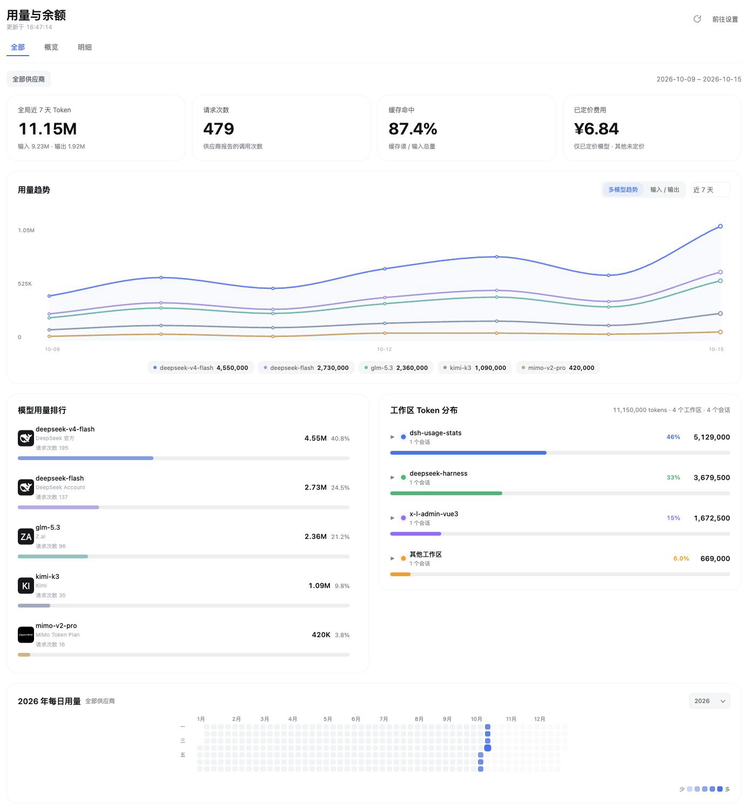
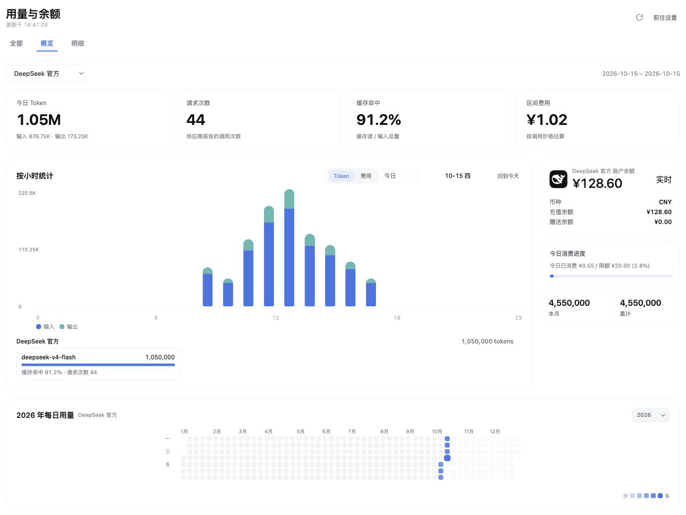
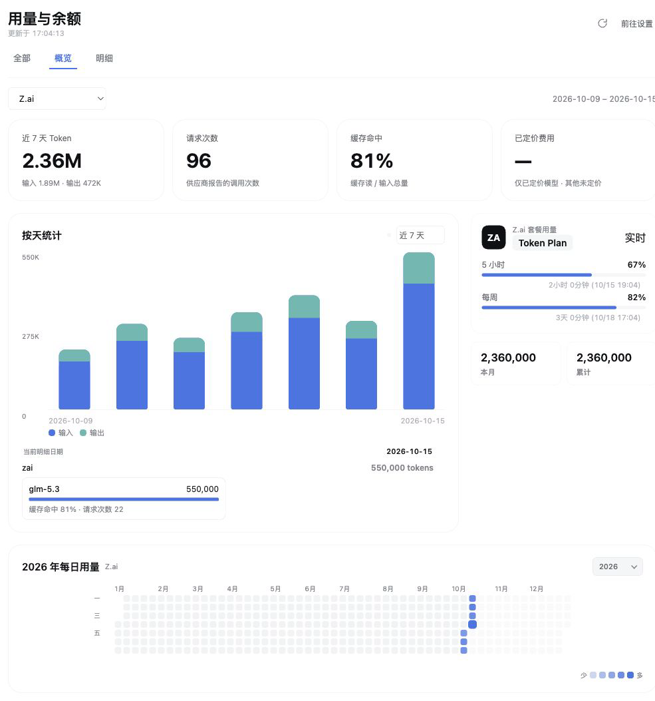
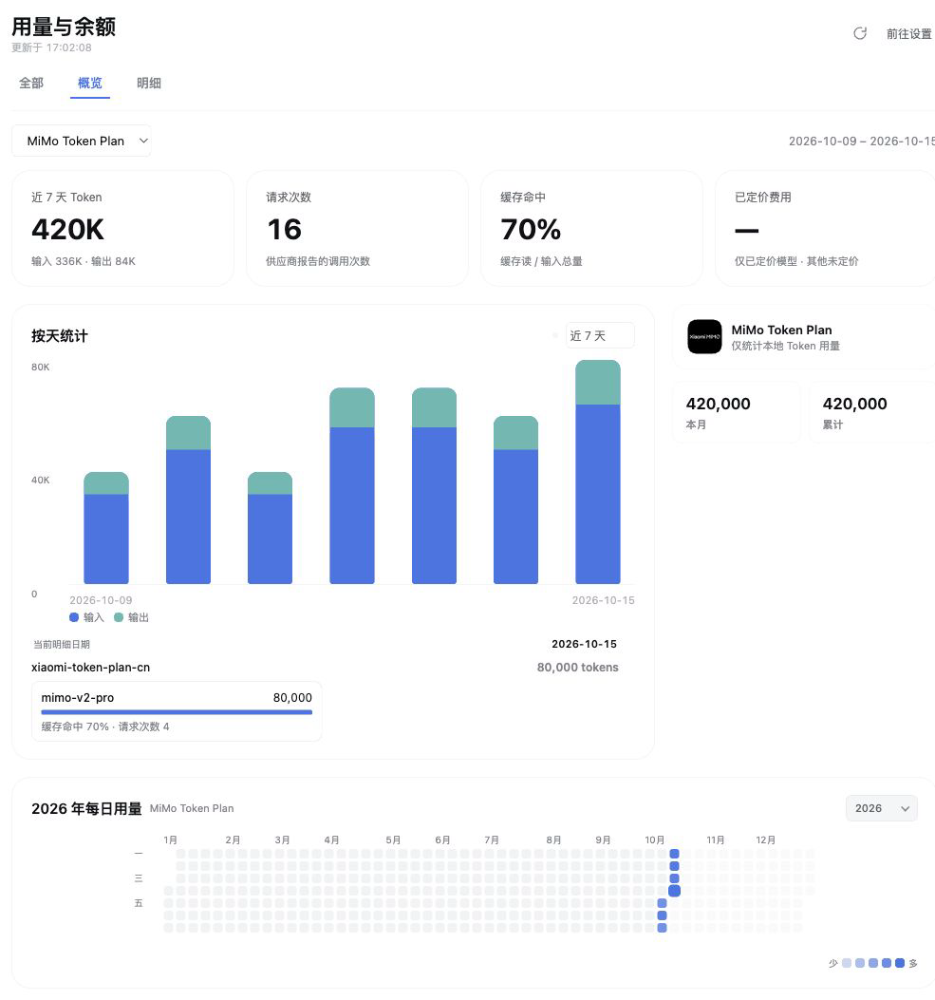
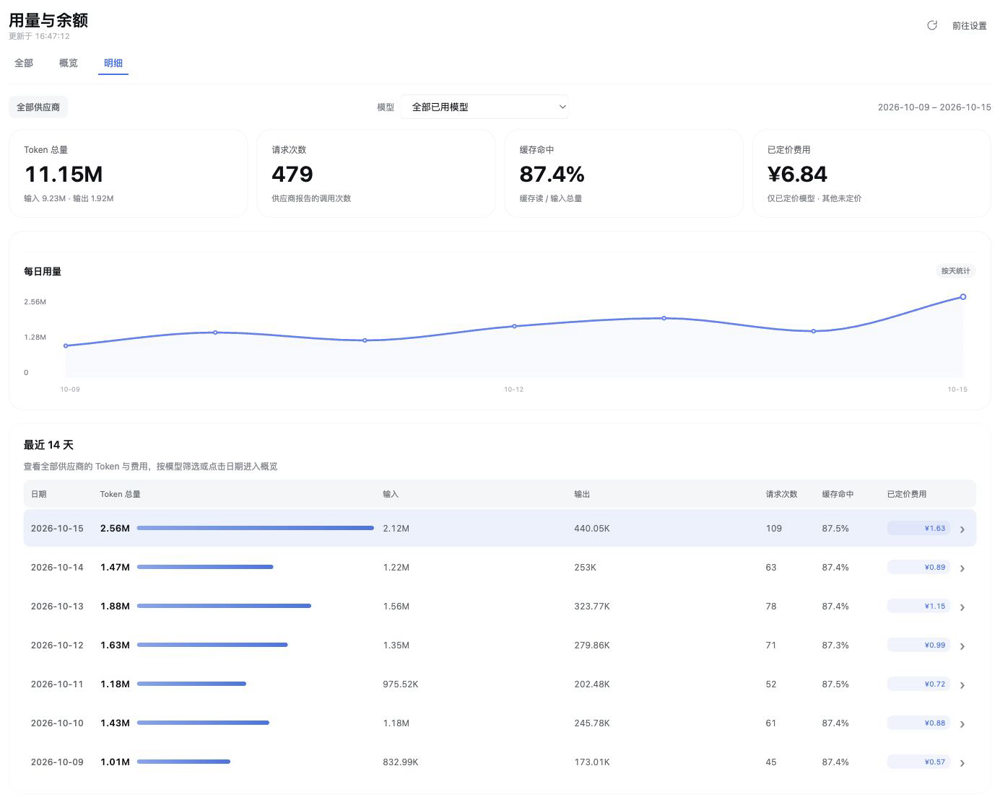
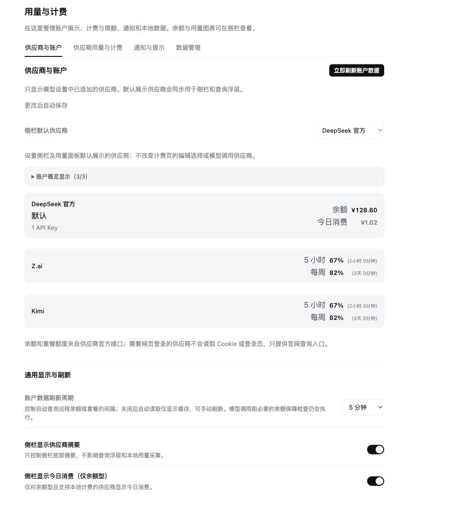
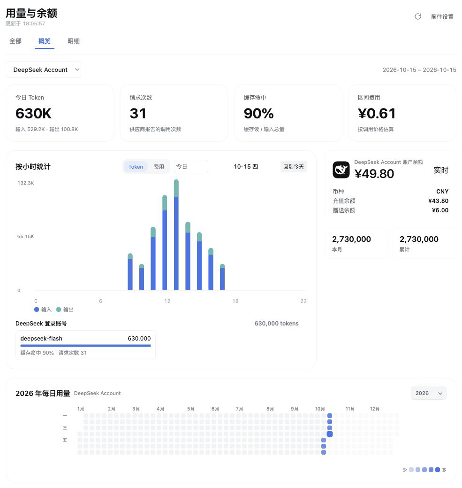
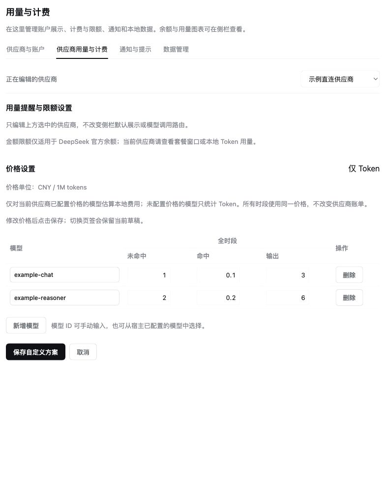
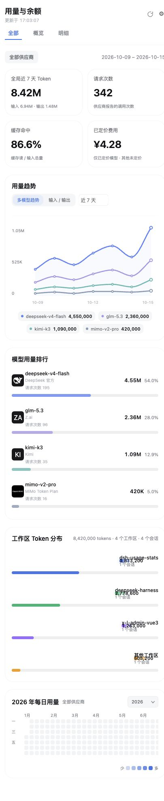
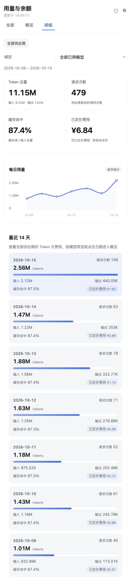

# dsh-usage-stats

面向 [DeepSeek Harness](https://github.com/deepseek-ai/deepseek-harness) Web GUI（`dsh web`）的本地用量中心：统一查看 Token、余额、套餐额度、DeepSeek 费用估算和每日趋势。

The local usage, balance, quota, and billing companion for DeepSeek Harness Web.

**文档导航：** [核心亮点](#核心亮点--features) · [Provider 支持](#provider-支持) · [界面预览](#界面预览--screenshots) · [快速安装](#快速安装--quick-start) · [配置](#配置--configuration) · [数据与隐私](#数据与隐私--privacy)

## 0.6.5 更新

- 简化升级提示：先复制命令、退出应用，再到终端更新并重新打开。
- 提供可复制的 `dsh` 更新命令，自动使用当前 Web 或桌面配置，固定更新到检查到的新版本；显示复制成功与失败提示。
- 已是最新版或等待重启时，不再显示手动更新步骤；支持一键升级的宿主继续使用原生更新流程。

## 0.6.4 更新

- 修复 hover 媒体查询语法；四项核心指标优先同排、窄屏换行，余额在堆叠概览中前置，日期明细的数值、比例条和费用标签统一对齐。更新当前组件的宽窄屏示例图。

- 升级检查适配宿主新契约：`viewProfilePackage` 显式传 `fields`；宿主提供 `listVersions`/`updateBundle` 时直接交给宿主完成版本检查、兼容预检、HMR 下卸载重装与失败回滚，旧宿主保留原流程。
- 修复宿主 ≥0.1.7 移除 `settings.get()` 后供应商 profile（模型页选择、自定义 baseURL/apiKeyEnv）读取静默降级的问题，改读原生 `settings.describe()` 目录。
- 性能：限额关闭时跳过每次官方调用前的账本渲染；账本写入、全局去重窗口与多行读一致性优化；工作区会话标题读取改为有界并发。
- 客户端：限额/套餐卡片失败可见并可重试；热图悬停与派生聚合降重渲染；请求可取消；轮询降频；错误容器与热图键盘可访问性；右栏原生入口/标题/菜单与 `keepMounted` 接入；顶层错误边界。
- 数据安全：按日裁剪需要二次确认且至少保留两天；登录账号计费口径与硬停止边界在文档中明确。
- 打包/CI：修正必需 peer 范围对宿主预发布版本的接纳；展示元数据（图标与本地化标题/描述）、npm 包体积裁剪、CI 固定宿主 tag 并增加 master 漂移任务、测试入口收敛。

## 0.6.3 更新

- 兼容桌面宿主 `0.2.0-rc.2` 的旧插件信息格式，修复已安装 npm 插件无法显示升级入口；保留原安装来源及管理保护。
- 已安装 `0.6.1` / `0.6.2` 的旧桌面宿主需通过插件管理器或配套 CLI 手动更新一次，重启后使用修复后的检测逻辑。

## 0.6.2 更新

- 修复切换历史日期后顶部指标归零，保持 Token、请求次数、缓存命中率、费用与图表一致。
- DeepSeek API Key 与登录账号均可查询余额；两套 Token、消费金额和余额分别统计，共用计价规则。
- 默认展示可自动跟随宿主已配置可用的供应商，保留原有手动选择。
- 修复全局明细钻取到错误供应商、热图提示旧快照和部分定价费用图归零，并补齐账户切换与设置刷新竞态保护。

## 0.6.1 更新

- 重排「全部 / 概览 / 明细」，突出区间指标、模型趋势与工作区分布；圆润图表适配宽窄容器与明暗主题，年度热图图例位于右下角。
- 仅有新版本时显示升级入口，按 npm、Git、本地目录和压缩包安装方式处理；适配最新宿主的 HMR 安装限制、profile 认证源、进度与结果恢复。
- 默认价格按 2026-10-15 官方页面核对，保留 V4 Pro 原价和旧 Flash 型号兼容计费；自定义方案支持增删模型、编辑名称和价格。
- 其他直连供应商可按「供应商 + 模型」配置价格；未设价默认只统计 Token，已冻结历史费用保持原值。

## 0.5.4 更新

- 对照 Harness `0.2.0-rc.2` 和当前 `0.2.1-alpha.1` 源码，“前往设置”直接打开原生「用量与计费」页；旧宿主保留入口回退。
- DeepSeek 登录账号的 Token 按现有 DeepSeek 模型价格估算费用，不计入 API Key 消费限额；账号余额仍由宿主管理。
- 其他和自定义供应商继续记录 Token，不推断未知价格；旧版账号账本未冻结金额时显示未知费用。

## 0.5.3 更新

- 对照 Harness `0.1.7-rc.2` 适配新版 Settings/Config：插件设置接入宿主配置编辑器，旧 JSON 设置在插件激活后导入。
- “前往设置”适配新版账户菜单，同时保留旧版设置按钮路径；焦点样式使用宿主主题变量。
- 兼容新旧 UI 图标导出名，修复右侧 Sidebar 的 React #130 空白页；测试会核对当前宿主实际导出。

## 0.5.2 更新

- 适配并声明支持 Harness `0.1.6-alpha.1`，保留 `0.1.5-rc.2` 开发依赖回归。
- 卸载前排空已接受的用量写入，按 `session/disposed` 清理会话缓存，同时保留正在落盘样本的去重身份。
- 工作区报告随用量刷新；切换范围清除旧数据，后台暂停轮询，失败提供重试。
- 通知和数据设置明确展示初次读取状态，数据操作等待统计刷新后恢复按钮。
- 图表和状态边框使用宿主主题色，遵循减少动态效果偏好，窄屏保留设置入口。

## 核心亮点 / Features

| 能力 | 你可以做什么 |
| --- | --- |
| 用量查询中心 | 有活动会话时从侧栏打开宿主原生右侧 Sidebar；无活动会话时打开宿主全局主面板；旧宿主再回退到 Modal |
| 多供应商账户 | 展示 DeepSeek/Moonshot 余额、Z.ai/Kimi/MiniMax/OpenCode Go 套餐窗口、OpenRouter Key 额度与账户 Credits；小米及 MiMo Token Plan 提供官方查询入口；账户概览最多固定 3 个供应商 |
| 时间与模型分析 | 查看今日 / 本月 / 累计 Token、请求次数、24 小时输入输出、模型拆分、缓存命中率与自然年贡献热图 |
| 费用与限额 | 冻结 DeepSeek 官方调用费用，配置每日消费限额、余额提醒、预警比例、通知和可选超限停止 |
| 本机数据边界 | API Key 只在服务端凭据服务中解析；统计账本、设置和告警保存在本机，插件 RPC 仅经宿主本机认证围栏访问 |

> 查询面板保持只读。默认展示供应商、计费、限额、通知和数据管理统一位于「设置 → 用量与计费」。切换默认展示供应商不会改变模型调用路由。会话过程显示由 Harness 原生「设置 → 通用设置 → Conversation display」控制。

### 数据口径

- Token 来自 provider-reported `usage`（`assistant/chunk`、`assistant/message` 或 `llm/stream` usage chunk），统计 API 不使用本地 tokenizer 估算。
- 请求次数按 `provider/model` 的独立用量样本统计；同一 `(turn, step)` 的流式中间样本与最终样本只计一次。冻结归档沿用每个模型桶的 `entryCount`。
- 调用级 ledger 按 `provider/model` 归集；日期、小时、费用和「今日」限额均按请求完成时间对应的北京时间计算。
- `deepseek-official` 与 DeepSeek 登录账号默认按官方价格估算；其他直连供应商仅在为具体模型保存自定义价格后计价，否则费用显示 `—`。API Key 消费限额与硬停止仍仅适用于 `deepseek-official`；登录账号费用计入本地统计与限额展示，但宿主不经过 API-Key 拦截，请求检查以 `account_billed_not_gated` 说明该边界。套餐窗口保留供应商原口径。
- 界面支持中文和英文；供应商列表来自 Harness 当前已经添加的可配置 provider route，不会猜测或探测未知远端接口。

## 用量面板与升级

「全部 / 概览 / 明细」共用区间指标：Token、请求次数、缓存命中率与费用。全部展示跨供应商模型趋势、区间模型排行和工作区比例；概览仅统计所选供应商，账户余额与今日限额独立显示。明细提供按日记录和模型筛选，窄容器自动改为卡片。图表使用圆角柱形、平滑折线与胶囊条形，年度热图图例固定在卡片右下角；布局按面板容器宽度切换，支持明暗主题。

查询面板打开时自动只读检查发布版本，结果缓存 5 分钟；仅在检测到新版本且能识别当前 npm 安装时显示「升级」。宿主提供原生 registry 更新能力（`listVersions`/`updateBundle`）时，检查、兼容性预检、HMR 下卸载与重装、失败回滚、进度和重试全部由宿主插件管理器执行，插件只展示状态并触发更新；旧宿主保留原有流程：启用 HMR 时引导到宿主插件管理器或退出宿主后用配套 CLI 更新，未启用 HMR 时由 profile 插件管理器安装固定新版本并提示重启。没有新版本或检查失败时隐藏按钮；插件不会尝试卸载自身；重复点击不会启动第二次安装。

升级状态由查询页面统一管理，关闭升级弹窗后仍会跟踪安装进度，迟到的检查响应不会覆盖安装结果。支持常见 npm 版本范围和 tag 写法，升级目标为 `latest` 稳定版本。版本查询复用宿主公开的 `viewProfilePackage` 操作，在当前 profile 目录中运行其配套 pnpm，沿用 `.npmrc` 的认证、代理、scope registry 和运行环境；宿主未提供该操作时不退回匿名 HTTP 查询。主源网络错误、超时或副本缺失时尝试宿主配置的备用 registry；沿用宿主对 profile 自有私有源的隔离规则，认证拒绝和异常包元数据不触发换源。要求调用方显式字段的宿主会收到 `name`/`version`/`description`/`dsh`，旧宿主忽略该选项。原生更新先从宿主 `listVersions` 的结果中选择最新兼容、未弃用、非预发布版本，再由宿主按其 registry plan 完成 `engines.dsh`/peer 兼容预检、HMR 下的删除与安装，以及安装失败后的旧版本恢复。

自动安装使用宿主 `requestId` 关联进度和结果；原生更新跟随 `plugin-manager/update-state` 步骤，旧宿主跟随 `install-state`。丢失结果时用 `waitForInstall()` 只读核对（原生更新则比较已安装版本与目标版本），不再次安装；宿主不保留已结束任务且无法核实时维持“未确认”，不推断成功。客户端响应宿主变更、安装进度和连接恢复事件，事件可用时每 10 秒兜底核对，旧宿主每 2 秒轮询，隐藏页面暂停轮询。失败时显示可处理的错误分类、待审批依赖脚本和重启原因，不回传原始 pnpm 日志或认证配置。

其他安装来源保持原样：Git 安装应在宿主插件管理器按原仓库与引用处理，固定 tag 或 commit 需显式选择新版引用；本地目录 / `link:` / `file:` 安装应更新源代码后重启、刷新；压缩包安装需重新选择新版文件。以上来源不会被自动替换成 npm 包。宿主未提供管理服务或未公开安装来源时不显示自动升级入口。

## Provider 支持

| route 示例 | 远端查询 | 能否直接复用模型设置中的 Key | 展示与额外操作 |
| --- | --- | --- | --- |
| `deepseek-official`、`deepseek` | `/user/balance` | 可以 | API Key 所属账户的余额、CNY 费用估算、每日消费限额与余额提醒 |
| `deepseek-account` | 宿主 `deepseekAccount.getBalance()` | 使用宿主登录凭据，无需 API Key | Web 与桌面端均可查询登录账号余额；充值与赠送按同币种合计，优先展示 CNY；宿主未提供查询服务时保留本地用量与费用估算 |
| `moonshotai`、`moonshotai-cn` | `/v1/users/me/balance` | 可以 | USD/CNY 可用余额、现金与代金券余额；Key 必须与国际/国内站匹配 |
| `openrouter` | `/api/v1/key`，可选 `/api/v1/credits` | Key 查询可复用 | 普通模型 Key 的消费上限、已用与剩余额度；账户 Credits 需额外配置 `OPENROUTER_MANAGEMENT_KEY`，不会拿普通模型 Key 试探该接口 |
| `opencode-go` | `/zen/go/v1/usage` | 可以 | OpenCode Go 5 小时滚动 / 每周 / 每月订阅窗口；已有接口查询，不重复显示官网按钮 |
| `opencode` | 无 API-key 余额接口 | 不适用 | 不读取网页登录态；显示 [OpenCode Zen workspace 查询入口](https://opencode.ai/workspace/wrk_01KN1AVY46S9P0AQNE6GNGNQE0) |
| `kimi-coding` | `/coding/v1/usages` | 可以 | 5 小时 / 每周 Token 窗口；月总额度不读取网页登录态，提供 [Kimi 我的额度](https://www.kimi.com/membership/subscription?tab=quota) 入口 |
| `minimax`、`minimax-cn` | Token Plan 查询（兼容多个官方路径） | 可以 | 5 小时 / 每周比例窗口 |
| `zai`、`zai-coding-cn` | `/api/monitor/usage/quota/limit` | 可以 | 5 小时 / 每周剩余比例与重置时间 |
| `xiaomi` | 无稳定的 API-key 用量接口 | 不适用 | 不读取网页登录态；显示 [MiMo API Key 用量入口](https://platform.xiaomimimo.com/console/usage) |
| `xiaomi-token-plan-cn`、`xiaomi-token-plan-ams`、`xiaomi-token-plan-sgp` | 暂无稳定的 API-key 配额接口 | 不适用 | 不读取 Cookie/CDP；显示 [MiMo Token Plan 官网查询入口](https://platform.xiaomimimo.com/console/plan-manage) |

`declared` 只表示 Harness 目录来源，不代表官方认证。插件仅过滤 `vision-toolkit-*` facade，其余已添加 route 按 Harness 原名展示；没有内置远端适配器的 provider 仍可统计本地 Token。

## 设置结构

「设置 → 用量与计费」按职责拆分为四个标签：

| 标签 | 内容 |
| --- | --- |
| 供应商与账户 | 选择默认供应商和最多 3 个账户概览项，查看账户快照，配置额外只写查询凭据、刷新周期与侧栏摘要；不会修改模型调用路由 |
| 供应商用量与计费 | DeepSeek 限额、余额提醒、峰谷价格与可选硬停止；其他直连供应商的模型自定义价格；套餐 provider 的窗口状态阈值 |
| 通知与提示 | 侧栏状态点、页面 Toast、预警/超限/余额不足/恢复事件、冷却时间和进程内告警历史 |
| 数据管理 | 近期精细记录、冻结金额精确归档与历史估算范围；按北京日历裁剪（需二次确认，至少保留两天）、恢复估算或二次确认清空本地数据 |

默认供应商可选择「自动」：优先跟随宿主当前已配置可用的默认供应商，再选择可用的登录账号或 API Key，最后按 Web / 桌面运行环境兜底。该设置只决定插件展示，不修改宿主模型路由。已有的手动默认供应商保持不变，也可随时手动切换或改回自动。账户概览始终保留实际默认供应商，最多显示 3 个。

每日消费进度只表达「今日消费 / 每日限额」，不会被余额提醒状态改变。套餐阈值仅控制状态提示颜色，不会修改供应商真实额度。

### 模型价格

默认 DeepSeek 价格核对于 2026-10-15，单位为 **CNY / 百万 Token**，列顺序为输入未命中、输入命中、输出：

| 模型 | 低谷 | 高峰 |
| --- | --- | --- |
| `deepseek-flash` | 1 / 0.02 / 4 | 2 / 0.04 / 8 |
| `deepseek-v4-pro` | 4.5 / 0.15 / 13.5 | 9 / 0.30 / 27 |

旧 `deepseek-v4-flash` 与 `deepseek-v4-flash-vision-exp` 按 Flash 价格计费；V4 Pro 继续独立提供服务。参见 [官方定价](https://api-docs.deepseek.com/zh-cn/quick_start/pricing/) 与 [官方更新说明](https://api-docs.deepseek.com/zh-cn/updates/)。历史型号原价仅用于切换前估算，已冻结账本不随当前价格变化。内置时段使用北京时间与周末规则，尚未内置中国法定节假日日历；节假日估算需自行核对，最终扣费以供应商账单为准。

在「设置 → 用量与计费 → 供应商用量与计费」选择直连供应商，可以参考宿主当前已添加供应商的生效模型列表，也可以手填模型 ID。自定义方案支持新增、改名、删除与价格编辑；升级不会覆盖已有自定义方案，可使用「恢复官方价格」切换到新默认值。保存后用于新调用估算；旧的 Token-only 冻结记录和导入日志不补计。其他供应商默认不配置任何价格，只统计 Token；同名模型在不同供应商之间互不影响。价格统一按 CNY / 百万 Token 填写，其他币种需先自行折算；套餐额度不换算为按量费用。恢复官方价格只重置 DeepSeek 方案，保留其他供应商的自定义价格。

## 界面预览 / Screenshots

查询中心首次打开进入「概览」并聚焦默认展示供应商；「全部」以多模型趋势、跨供应商模型排行和工作区 Token 分布汇总全局用量；「明细」可从全部供应商历史用过的模型中筛选最近日期用量。套餐供应商显示窗口额度和重置时间，余额型供应商显示余额；年度热图、小时趋势和模型拆分适用于各类已记录用量。示例图基于 0.6.4 的当前插件组件、宿主主题和演示数据重新截取，不包含真实账户或凭据；空间足够时四项指标同排，窄屏自动换行，堆叠概览将余额置于图表上方。点击缩略图可查看原图。

<table>
  <tr>
    <td align="center"><a href="docs/assets/screenshots/usage-overview-all.png"></a><br /><sub>全部供应商概览</sub></td>
    <td align="center"><a href="docs/assets/screenshots/usage-overview-deepseek.png"></a><br /><sub>DeepSeek 余额与用量</sub></td>
    <td align="center"><a href="docs/assets/screenshots/usage-overview-zai.png"></a><br /><sub>Z.ai 套餐额度</sub></td>
  </tr>
  <tr>
    <td align="center"><a href="docs/assets/screenshots/usage-overview-xiaomi-token-plan.png"></a><br /><sub>MiMo Token Plan</sub></td>
    <td align="center"><a href="docs/assets/screenshots/usage-details.png"></a><br /><sub>按日明细</sub></td>
    <td align="center"><a href="docs/assets/screenshots/settings-providers.png"></a><br /><sub>供应商与账户设置</sub></td>
  </tr>
</table>

<a href="docs/assets/screenshots/usage-overview-deepseek-account.png"></a>

DeepSeek 登录账号：独立显示余额、充值与赠送金额，以及该账号的 Token 和费用估算。

| 模型价格编辑 | 窄屏全部 | 窄屏明细 |
| --- | --- | --- |
| <a href="docs/assets/screenshots/settings-pricing.png"></a> | <a href="docs/assets/screenshots/usage-all-narrow.png"></a> | <a href="docs/assets/screenshots/usage-details-narrow.png"></a> |

## 快速安装 / Quick start

本版本对照 Harness `0.2.1-rc.3` 与当前 master 源码验证 UI、升级和计价契约；`0.6.2` 曾对照 `0.2.1-alpha.3`，`0.5.4` 曾对照 `0.2.0-rc.2`（桌面版）和 `0.2.1-alpha.1`，`0.5.3` 已对照 `0.1.7-rc.2` 修复兼容问题，`0.5.2` 以 `0.1.6-alpha.1` 为基线。开发依赖升级到 `0.2.1-rc.3`，`test:host-current` 继续直接加载当前宿主源码验证。包清单使用 `dsh.manifestVersion: 1`，并通过顶层 `engines.dsh` 声明完整 UI 兼容范围 `>=0.1.5-rc.1 <0.1.6-0 || 0.1.6-alpha.1 || >=0.1.7-rc.2 <0.1.8-0 || >=0.2.0-rc.2 <0.2.1-0 || >=0.2.1-alpha.1 <0.2.2-0`。宿主从 `0.2.1-alpha.3` 起以 `engines.dsh` 单独判定兼容性，因此每个宿主 minor 预发布前都必须同步扩展该范围并跑 `npm run test:host-current`；当前范围覆盖 0.2.1 线（含 rc.3），0.2.2 线需要随下一个宿主发布同步声明。要求 `web` profile；客户端 UI 依赖 `@deepseek-ai/dsh-client-ui-layout >=0.1.5-rc.1` 与 `@deepseek-ai/dsh-client-ui-primitives >=0.1.3-alpha.2`，独立 RPC channel 依赖 `@deepseek-ai/dsh-host-webserver >=0.1.3-alpha.2`，插件自身支持 Node.js `>=22.19`，运行最新宿主应遵守其 Node.js `>=24.9` 要求（rc.3 宿主要求 `^22.19 || >=24`）。插件直接依赖 `storageDomain`、`settings`、`connection.rpc`、`webServer` 与 `sessionPersistence`，不再兼容缺少这些官方 seam 的旧 Harness。服务端仍保留 `dsh-v0.1.2-alpha.3` 与 `dsh-v0.1.1-rc.2` 的接口读取路径，但旧宿主不再属于完整 UI 兼容范围。适配内容：宿主 RPC 通道自 `0.1.2-alpha.1` 起改由传输层统一认证（旧的通道级 `authority` 参数被忽略）；最新 Connection 契约要求独立 channel 的调用方同时注入 `connection` 与 `webServer`，使 route 归调用插件 Fiber 所有并随其卸载；`0.2.1-alpha.2` 起 Connection 自身对 `webServer` 改为可选子注入，而专用 channel 注册仍从 Connection owner Fiber 读取该服务，因此插件的 bundle patch 会同步给 Web profile 的 `connection` 行补充 `webServer`；该行在 `0.2.1-alpha.2` 的 inject 写成 `[webStartup, webServer]`——这一版用 `webStartup` 取代了旧宿主的 `webRuntime` 服务（两代宿主都提供 `webStartup`），trustedHosts 表达式改为优先读取 `webRuntime`、回退 `webStartup`，同一个 bundle patch 因此在两代宿主上都能装配；settings 自 `0.1.2-alpha.2` 起移除 `settingsNamespace()` 运行时 brand，插件改用纯字符串 namespace（两代宿主均接受）；persistence 读路径对未知事件类型 fail-closed——用量重建遇到由更新宿主写入、当前 Harness 运行时无法解读的 session 时会跳过并在 `unreadableSessions` 中计数，数据管理页会给出跳过提示，不再整体失败；session-persistence 自 `0.1.2-alpha.4` 起替换为 handle 化 API（`list`/`open('read')`），最新宿主的 `handle.read()` 返回 `{ eventState, events }`，插件会先归一化其中的 `events` 再重建；过渡版本直接返回事件数组、旧宿主使用 `listSnapshots`/`readFrom` 的路径仍可读取，所有新宿主只读句柄都会在读取后必达关闭；存储域声明 `invalidRecords: 'backup-and-skip'`（`0.1.2-alpha.5` 起），单日记录损坏时宿主自动备份该记录并继续打开，旧宿主保持原有的整体拒绝行为。存储格式同步升级到 v4（per-record 按日布局），首次打开自动拆分迁移既有 v3 单文件数据，升级前仍请保留 `$DSH_HOME/storages` 备份。

最新宿主适配还包括：历史重建按只读句柄的 `inheritedEventCount` 跳过 fork 继承前缀，避免父会话用量重复统计；读取 `assistant/attempt` 内嵌流的最后一份 usage，每个已结算尝试分别计入；实时重试以已结算尝试划分账本身份，成功消息只与自己的流式样本去重。旧宿主未提供继承边界时仍按旧读路径处理，不能保证 fork 历史去重。已有重建估算可在「数据管理」重新执行重建以更新，已冻结的实时历史不会被追溯改价或自动修正。

查询面板的「前往设置」优先调用宿主 `sidebar.settings` Store 的 `openSection("usage-stats")`，直接打开插件设置页；旧宿主沿用原生设置入口回退。DeepSeek 登录账号与 API Key 使用同一份本地价格策略估算费用，但 Token、消费金额与余额按账户分别统计，不合并，也不会把账号费用归入 API Key 限额。登录账号余额通过宿主公共账号服务查询，API Key 余额通过官方 API 查询；查询不可用时显示状态，不将缺失余额当作 0。其他直连供应商未设置价格时只统计 Token；可按供应商和模型自定义 CNY 价格，保存后仅为新调用计价，旧 Token-only 记录不补计。升级前的账号账本若未冻结金额，显示未知费用，不伪造零金额。

查询面板优先注册到最新宿主的原生右侧 Sidebar，可与主会话并排常驻；没有活动会话时使用宿主 `main` Slot 的全局主面板，布局服务或面板尚不可用时再回退到原生 Modal。Modal 继续支持 Escape、点击遮罩关闭和焦点返回侧栏。开关、状态标签、状态点与页面通知分别复用宿主 `Switch`、`Tag`、`StateDot`、`Toast`；右侧栏和全局面板使用宿主基础背景，侧栏入口高度、hover token 和窄栏尺寸与当前宿主 footer 对齐。插件不扫描或替换宿主设置图标，也不修改宿主布局。

升级前请保留 `$DSH_HOME/storages` 备份。首次启动会为旧 `usage-settings.json`、`usage-limits.json`、`usage-stats-cache.json` 创建固定 `.pre-v3.bak` 并迁移到官方存储；降级只能恢复升级前备份，`0.2.0` 期间新增的 v3 数据不会双写回旧格式。

**本地 checkout 安装（开发推荐）**：在**包含插件目录的父目录**中执行（官方文档：从包含该包的目录运行），或已在插件根目录内用 `.`：

```bash
# 在 dsh-usage-stats 的父目录中执行
dsh plugin --profile web add ./dsh-usage-stats

# 或者已进入插件根目录
cd dsh-usage-stats
dsh plugin --profile web add .
```

目录路径安装会生成 `link:`（符号链接）依赖：改动插件代码**无需重新安装**，**重启正在运行的 `dsh web`** 并在浏览器硬刷新（Cmd/Ctrl+Shift+R）即可生效；侧栏底部会出现独立的「用量/余额」入口。

**从 npm 安装**：

```bash
dsh plugin --profile web add @wannanbigpig/dsh-usage-stats
```

**从 GitHub 安装**：

```bash
dsh plugin --profile web add github:wannanbigpig/dsh-usage-stats
```

如需安装本地 tarball，可在 checkout 根目录执行：

```bash
package_tarball="$(npm pack --silent)"
dsh plugin --profile web add "./${package_tarball}"
```

**升级或卸载**（`update` 只对 npm/GitHub 安装的副本有意义；本地 `link:` 安装始终指向本地目录，直接 `git pull` 后重启 `dsh web` 即可）：

```bash
dsh plugin --profile web update @wannanbigpig/dsh-usage-stats
dsh plugin --profile web remove @wannanbigpig/dsh-usage-stats
```

## 凭据 / Credentials

插件通过 Harness 凭据服务读取 API Key，不会创建或修改凭据，也绝不把 Key 发送到浏览器。模型供应商的 Key 建议在 Harness「设置 → 模型」中保存；Harness 会把值写入 `$DSH_HOME/.credentials.yaml`，provider profile 只保留 `apiKeyEnv` 引用。也可以手动维护该文件，例如：

```yaml
# ~/.dsh/.credentials.yaml
version: 1
refs:
  DEEPSEEK_API_KEY: sk-your-key-here
  OPENROUTER_MANAGEMENT_KEY: sk-your-management-key-here
```

手动编辑后应限制文件权限：`chmod 600 ~/.dsh/.credentials.yaml`。以上均为占位符，不要把真实 Key 提交到仓库。

默认读取 `DEEPSEEK_API_KEY`。多个账号 / 多个 API Key 时，在插件配置里追加凭据引用（名称即可，不要写 Key 值）：

```yaml
# ~/.dsh/profiles/web/cordis.patch.yml
- insert:
    - id: usage-stats
      name: "@wannanbigpig/dsh-usage-stats"
      config:
        keys:
          - DEEPSEEK_API_KEY
          - DEEPSEEK_API_KEY_2   # 第二个账号的凭据引用
```

当当前 provider 暴露多个 API Key 时，弹窗余额卡片会显示「API Key」下拉框，可按 Key 查询余额。Token 统计来自调用级 ledger，日志不记录「用哪个 Key」，但记录 provider route；只有 `deepseek-official` 的消费可按 `keyProviders` 归集并参与限额。

其他 Harness provider 的 `apiKeyEnv` 由对应 provider profile 提供，例如 `MOONSHOTAI_CN_API_KEY`、`OPENROUTER_API_KEY`、`OPENCODE_GO_API_KEY`、`KIMI_API_KEY`、`MINIMAX_API_KEY`、`ZAI_API_KEY`。插件以 profile 中的实际引用名为准，因此通过「模型」页面保存的 Key 可以直接复用。

OpenRouter 是唯一需要双凭据的内置适配器：普通 `OPENROUTER_API_KEY` 继续用于模型调用和 `/api/v1/key`；如需账户总 Credits，切换默认供应商为 OpenRouter 后，在下方“额外查询凭据”中填写 Management Key。该值通过 Harness `credentials` seam 只写保存为 `OPENROUTER_MANAGEMENT_KEY`，不会进入插件 settings namespace 或被接口回显。Management Key 不能替代普通模型 Key，缺失或无权限时插件仍会显示普通 Key 额度，并独立标注 Credits 状态。

## 配置 / Configuration

所有配置都是可选的，默认值即可开箱使用：

| 字段 | 类型 | 默认值 | 说明 |
| --- | --- | --- | --- |
| `keys` | `string[]` | `["DEEPSEEK_API_KEY"]` | 余额查询使用的凭据引用列表 |
| `defaultKeyRef` | `string` | `DEEPSEEK_API_KEY` | 默认选中的 Key |
| `baseURL` | `string` | `https://api.deepseek.com` | DeepSeek API 地址（`/user/balance` 相对此地址） |
| `refreshMs` | `number` | `300000` | 启动配置中的余额缓存/刷新基线（毫秒，最小 5000）；设置页可选“关闭”停用服务端周期刷新 |
| `pricing.pricing` | `object` | 见下 | `deepseek-official` 模型单价（CNY / 1M tokens）覆盖 |
| `pricing.providerModels` | object | `{}` | 按供应商和模型配置完整单价，单位 CNY / 1M tokens；默认不为其他供应商定价 |
| `pricing.replaceModels` | boolean | `false` | 显式替换 DeepSeek 模型行；设置页增删改模型时使用，未设置保持旧配置合并语义 |
| `pricing.peakMultiplier` | `number` | `2` | 官方高峰时段价格为低谷时段的 2 倍 |
| `pricing.peakHours` | `[start,end)[]` | `[[9,12],[14,18]]` | 工作日高峰时段，北京时间 09:00–12:00、14:00–18:00；周末规则见下文 |
| `pricing.currency` | `string` | `CNY` | 消费金额显示货币；与 DeepSeek 中国区余额默认币种保持一致 |
| `keyProviders` | `object` | `{}` | Key → provider 路由列表；开启后今日消费按 Key 归集、限额按 Key 判定 |
| `maxLedgerEntries` | `number` | `5000` | 近期完整调用记录容量，可在数据管理页设置为 `100–5000`；超出后旧记录折入冻结金额精确归档 |
| `allowInsecure` | `boolean` | `false` | 允许非 HTTPS `baseURL`（不推荐） |

页面中的“默认展示供应商”和“账户概览显示”属于 Harness 官方 `usage-stats` settings namespace。配置按 schema defaults → 插件 Config base → 用户 section 合成；默认供应商初始为 `deepseek-official` 且始终包含在账户概览中。账户概览最多选择 3 个，这些设置不会修改模型调用路由。

当前内置远端适配器为：DeepSeek `GET /user/balance`、Moonshot/Kimi Open Platform `/v1/users/me/balance`、OpenRouter `/api/v1/key` 与可选 `/api/v1/credits`、OpenCode Go `/zen/go/v1/usage`、Kimi Coding `/coding/v1/usages`、MiniMax Token Plan（包含旧路径回退）、Z.ai `/api/monitor/usage/quota/limit`。普通小米 `xiaomi` 与 `xiaomi-token-plan-{cn,ams,sgp}` 当前没有稳定的 API-key 用量/配额接口，分别显示 API Key 用量页和 Token Plan 管理页；OpenCode Zen 仅显示固定 workspace 查询入口。插件不读取 Cookie、浏览器登录态或外部 CLI 配置；接口失败时保留明确状态，不会把错误当作零额度。

### 按 API Key 统计（keyProviders）

会话日志不记录「用哪个 API Key」，但每个请求都记录 provider 路由。当前只有 `deepseek-official` 路由参与 DeepSeek 消费归集和限额；外部 provider 的映射不会让其 Token 变为 DeepSeek 消费：

```yaml
# ~/.dsh/profiles/web/cordis.patch.yml
- insert:
    - id: usage-stats
      name: "@wannanbigpig/dsh-usage-stats"
      config:
        keys:
          - DEEPSEEK_API_KEY
          - DEEPSEEK_API_KEY_2
        keyProviders:
          DEEPSEEK_API_KEY: [deepseek-official]
```

未映射的 `deepseek-official` 消费归到 `defaultKeyRef`。**未配置 `keyProviders` 时**，所有 Key 共享官方全局今日消费（此时每个 Key 的每日限额按该金额判定）。余额始终按所选 Key 单独查询。

### 供应商用量与计费（设置 → 用量与计费 → 供应商用量与计费）

该标签可独立选择正在编辑的供应商，不会改变「供应商与账户」中的侧栏默认供应商或模型调用路由。DeepSeek 可**按 Key（或全局）**配置；**仅配置一个 API Key 时，「目标 API Key」选择器自动隐藏**：

- **启用限额**：开关。
- **消费限额**（CNY）：可按每日或每月周期设置。估算消费达到限额 × `alertPercent`（默认 80%）→ 黄色预警；达到限额 × `criticalPercent`（默认 90%）→ 红色已超限（仅提醒与告警，不拦截）；两个比例都可在设置页调整。
- **余额提醒线**：新鲜余额低于该值 → 余额预警；只影响余额状态和通知，不改变今日消费进度或侧栏今日消费圆点。余额过期或查询失败时显示灰色状态且 fail-open。
- **预警百分比**：可调整数范围；`alertPercent` 为 1–99%，`criticalPercent` 为 2–100%，且临界值必须高于预警值。
- **超限停止调用**：默认关闭，仅提醒；用户显式开启后，当前每日或每月周期的官方消费达到限额（100%）时，在 `llm/stream` 拦截新的官方模型调用（抛出 `UsageLimitExceededError`）。临界预警只显示状态并触发告警，不拦截；余额查询失败或快照过期时 fail-open。当前 UI 开启硬停止前会要求确认，其他限额变更会立即保存。

限额保存在同一个官方 settings namespace，当前 schema 为 v2。旧 v1 文件会安全迁移：保留提醒规则，但不会自动继承旧 `stopOnExceed` / `minBalance` 为硬停止；用户需在设置页重新确认开启。**规则解析采用全局兜底**：某个 Key 未设置数值时沿用全局限额。拦截采用 **fail-open** 策略：限额检查本身出错时放行调用。

状态统一为 `normal / warning / exceeded / blocked / stale / unavailable / unpriced`。`unpriced` 表示当前消费周期含未定价的 DeepSeek 模型，消费金额不可靠，对应限额不参与拦截且 fail-open。侧栏状态点与设置页读取同一个 `/limits` 状态源；告警只在状态跨越或冷却到期时触发，恢复正常时生成一次恢复事件。

默认单价（CNY / 1M tokens，对应 DeepSeek 官方中文价格页，2026-10-15）：

| 模型 | 命中·低谷 | 命中·高峰 | 未命中·低谷 | 未命中·高峰 | 输出·低谷 | 输出·高峰 |
| --- | --- | --- | --- | --- | --- | --- |
| `deepseek-flash` | 0.02 | 0.04 | 1 | 2 | 4 | 8 |
| `deepseek-v4-pro` | 0.15 | 0.30 | 4.5 | 9 | 13.5 | 27 |
| 未配置模型 | — | — | — | — | — | — |

自北京时间 **2026-08-23 00:00** 起，周六、周日全天按低谷价；周一至周五继续在 09:00–12:00、14:00–18:00 使用高峰价，其余时段使用低谷价。`deepseek-v4-flash`、`deepseek-v4-flash-vision-exp` 自 **2026-09-10 00:00** 起映射到 `deepseek-flash` 计费；`deepseek-v4-pro` 继续提供服务，始终保留上述 Pro 价格，不转为 Flash 计费。所有生效时间均为北京时间。

每次调用以 `costNanosCny` 冻结金额，压缩、重启或后续改价都不会重算；只在返回 UI 时舍入到六位小数。未识别的官方模型为明确 `unpriced`；其他供应商未设置价格时仅统计 Token，明确保存单价后冻结该供应商模型的新调用费用，不混入 DeepSeek API Key 限额。

价格覆盖可以只填写需要调整的字段，未填写的输入命中/未命中/输出单价会继承当前模型值；在「供应商用量与计费」中点击「自定义价格」会带入当前方案，保存后新账本使用新价格。也可点击「获取官方定价」：服务端访问固定的 DeepSeek 官方价格页，并尝试从项目固定 GitHub URL 读取只包含价格与型号路由的声明式 JSON 策略。远程策略必须通过受限 schema 校验，获取或校验失败时使用内置最后有效策略；不下载或执行远程代码。完整的峰谷价格和路由会先展示确认表；用户点击「确认并填入」只会更新编辑草稿，仍需点击保存才会生效。空值、非数字和负数会被前后端拒绝；`peakHours` 必须满足 `0 <= start < end <= 24`。

## 使用 / Usage

1. 侧栏底部 **用量/余额** 会直接显示默认账户余额与今日消费（今日消费为 0 时不显示该段）：本地账本每次成功写入后，今日消费会在约 1 秒内更新；远端余额遵循账户刷新周期，查询面板打开时每分钟同步摘要，关闭时每 5 分钟同步。点击整行优先在宿主右侧 Sidebar 打开查询中心；没有活动会话时打开宿主全局主面板，宿主不提供该能力时再回退到 Modal。窄侧栏模式只显示数据图标。
2. 查询中心分「全部 / 概览 / 明细」三个标签，默认打开「概览」：全部 = 跨供应商 Token 汇总、多模型趋势、供应商/模型排行、工作区 Token 分布与年度热图；概览 = 默认供应商的账户卡、摘要、小时统计、模型拆分与年度热图；明细 = 全部供应商历史已用模型的筛选与最近日期按日明细。点击日期时，若当天筛选结果只属于一个仍在配置中的供应商，会联动该供应商的概览小时图；跨供应商或已移除供应商的历史会打开全部报告，保留当日及模型筛选，避免切到无关账户。手动点击「全部」恢复全模型范围。

   查询报告每分钟刷新时同步更新工作区分布；页面进入后台后暂停报告轮询，回到前台立即刷新。切换查询范围时清除旧范围的数据，工作区读取失败可在图表内重试。账户、通知与数据设置在读取成功前禁止编辑，失败时提供重试；账户刷新与数据操作等待最新快照返回后才恢复操作按钮。图表颜色和状态边框使用宿主主题变量，动效遵循系统“减少动态效果”偏好。

3. 账户余额卡片：分别展示 DeepSeek API Key 账户或登录账号的余额 + 充值/赠送明细；API Key 有多个时可切换；右上角刷新时图标会持续旋转到请求结束，旁边有「前往设置」链接。余额查询失败会缓存错误快照并在 `refreshMs`（默认 5 分钟）内复用，网络错误时余额显示「暂不可用」。
4. 「年度每日用量」：默认只展示今年 1–12 月；右上角切换年份，悬停方块查看整日日期、Token、输入/输出、缓存、费用和模型摘要，点击方块联动当天明细。
5. 「按小时统计」：展示所选日期的 24 小时输入/输出柱状图；零用量小时不渲染数据柱，工作日高峰时段以跨全图的浅色背景区段提示，周末不显示高峰区段并标注全天低谷价；鼠标悬停、键盘聚焦或触屏点击某小时可查看总 Token、输入、输出、缓存、费用和模型拆分。费用与 Token 按**请求完成时间（usage 上报时间）**（北京时）归入对应日期与小时：跨整点或跨日边界的流式请求同样按完成时间归属（如 17:59 发起、18:01 完成的请求计入 18 点小时并按低谷价计费，而不是计入 17 点高峰价），与官方账单口径一致。
6. 限额、价格、通知和展示配置请在「设置 → 用量与计费」中操作；「供应商用量与计费」可独立选择正在编辑的供应商。DeepSeek 可按 Key（或全局）配置每日或每月消费限额、余额提醒线、预警百分比与是否停止新调用；套餐供应商只显示其支持的窗口阈值；开启硬停止时会弹出确认。

## 官方 tokenizer 离线计算

实际请求统计始终使用模型响应中的 provider-reported `usage`。这是账单与缓存命中最接近的口径；离线 tokenizer 只能计算传入的可见文本，无法还原服务端 system prompt、工具定义、缓存读写或隐藏推理 Token，因此不会混入余额与费用统计。

若已从 DeepSeek 官方文档下载 `deepseek_v3_tokenizer`，可用其 `tokenizer.json` 与 `tokenizer_config.json` 做离线文本计算（离线计数默认**不含 BOS/EOS 等特殊 token**）：

```bash
npm run tokens -- \
  --tokenizer-dir /Users/liuml/Downloads/deepseek_v3_tokenizer \
  --json 'token 用量计算'
```

也可通过环境变量 `DEEPSEEK_TOKENIZER_DIR` 指定目录，或从 stdin 输入文本。该实现使用 Hugging Face 的 `@huggingface/tokenizers` 直接读取官方文件，不需要 Python `transformers`。

> 注意：`npm run tokens` 属于开发/诊断工具，`scripts/` 不随 npm 包发布，该命令仅在**源码仓库 checkout** 下可用；通过 npm 安装的插件包不含此 CLI。

## 数据与隐私 / Privacy

- API Key 只在服务端凭据服务中解析，响应中只有余额数值，没有任何 Key。DeepSeek 登录账号余额仅通过宿主公共账号服务读取，不读取浏览器 Cookie、复制登录 Token 或自行存储账号凭据。
- Host 只注册官方 Connection RPC `/usage-stats`，不注册自有 REST route、Host fence 或 JSON body parser。`dsh-v0.1.1-rc.x` 上通道由 `authority: "loopback"` 围栏保护；`dsh-v0.1.2-alpha.1` 起宿主忽略该参数，改为在传输层统一认证（签名浏览器 cookie + launch token + 回环围栏），插件注册保持双版本兼容。
- `usage_stats` storage domain 自存储格式 v4 起采用宿主 per-record 布局：近期 ledger 按北京日历拆为每日一行、精确冻结归档按日一行，去重窗口、coverage cutoff、估算来源和迁移标记存放在全局槽。一次采样只重写当天的日记录和小的全局文档，单个损坏文件读为空行而不影响整个状态；旧版本 v3 单文件在首次打开时自动拆分迁移。
- 插件不保存提示词、回复、文件路径或 API Key。`llm/stream` 最终 usage 是调用级权威数据，`assistant/message` 仅在没有匹配 stream usage 时补记；缺少 `turn/step` 时按同一 `sessionId/provider/model` 的短期关联键去重。
- 「重建估算」只恢复每天首次记账之前的历史。当天开始记账后因停用插件或写入失败遗漏的用量，目前不能自动补回：冻结归档不保留全部调用身份，放宽恢复范围会有重复计费风险。
- 余额与套餐查询在宿主进程内直接外呼各供应商 API；自 `dsh-v0.1.2` 起宿主为每个 profile 安装进程级代理策略（代理配置可来自 Harness-home `.env` 层），这些查询会透明跟随宿主代理。若配置了拦截型代理策略，查询失败时请先检查宿主代理配置。

## Connection RPC

官方 channel 为 `/usage-stats`，endpoint 为：`upgrade/get`、`upgrade/check`、`upgrade/start`、`usage/get`、`keys/list`、`providers/list`、`balance/get`、`limits/get`、`limits/update`、`accounts/get`、`accounts/update`、`pricing/get`、`pricing/models`、`pricing/update`、`alerts/get`、`alerts/update`、`data/get`、`data/trim`、`data/clear`、`data/rebuild-estimated`。业务失败始终返回 `RpcResult`，不会把异常抛穿 bridge。

Harness 当前没有公开的 standalone Node generic RPC client。源码仓库中的恢复 CLI 只是 envelope 调用器，要求显式 `--base-url`，默认 dry-run；确认后追加 `--apply`：

```bash
node scripts/rebuild-today-legacy.mjs --base-url http://127.0.0.1:3080
node scripts/rebuild-today-legacy.mjs --base-url http://127.0.0.1:3080 --apply
```

## 开发与验证 / Development

```bash
npm install
npm test
npm pack --dry-run
```

`npm run check` 由 `scripts/check-all.mjs` 统一执行语法检查并叠加 `check:client-css`；`npm test` 由 `scripts/test-all.mjs` 顺序执行纯函数、客户端与官方 seam 集成测试。CI 会构建相邻 `deepseek-harness` 源码后再跑集成测试；本地缺少该源码时 JSON backend 集成测试会明确跳过，可用 `npm run test:storage-json` 强制执行：
- `scripts/test-usage.mjs`：折叠语义（替换不重复计数、跨日移动）、小时桶、费用计算、真实会话日志折叠（设置 `DSH_SESSION_LOG` 指向 `session.jsonl` 可复现）；
- `scripts/test-tokenizer.mjs`：`tokenizer.json` / `tokenizer_config.json` 加载、编码计数与缺失文件错误；
- `scripts/test-server.mjs`：官方 settings/storage/connection/sessionPersistence 生命周期、RPC authority、stream 权威落账与晚到消息去重；
- `scripts/test-official-state.mjs`：v1/v2 迁移、备份冲突、schema、settings mutate 与 storage repository；
- `npm run test:host-current`：对照当前宿主验证 UI 导出、HMR 升级限制、无 HMR 安装契约与隔离认证 registry 的真实 pnpm 查询；本地可用 `DSH_TEST_PNPM_JS=/absolute/path/to/pnpm/bin/pnpm.cjs` 指定桌面版配套包管理器。测试安装使用替身，不修改真实 profile；认证查询只访问临时本地服务。
- `scripts/test-storage-json-integration.mjs`：目标 Harness JSON backend 的 v2 迁移首次写入、120 并发写、压缩、关闭重启和改价冻结；
- `scripts/test-providers.mjs`：DeepSeek/Moonshot/OpenRouter/OpenCode Go/Kimi/MiniMax/Z.ai 适配器的离线 mock、鉴权错误、超时和 MiniMax 回退顺序；
- `scripts/smoke-client.mjs`：客户端 bundle、侧栏入口、自然年贡献热图、小时悬停浮层、刷新动画、统一状态映射与硬停止设置契约；
- `scripts/test-pricing-review.mjs`：价格覆盖优先级、峰值倍率与自定义模型继承（legacy 输出 × peakMultiplier、显式 peak 优先、零值显式、未填字段继承）；
- `scripts/test-review-services.mjs`：限额/余额/provider 服务契约（禁用规则不贡献限额与硬停止、刷新节奏、月度阈值与全局/按 Key 兜底、host key/baseURL 联动）；
- `scripts/test-settings-interaction.mjs`：jsdom 渲染客户端，验证设置交互（页签键盘导航、供应商本地选择、价格草稿跨页签保留）。

真实数据验证需运行 `dsh web`，然后打开「用量/余额」弹窗；不再提供旧 REST curl 接口。

针对相邻宿主最新源码的独立验证（需先在宿主目录执行 `pnpm install` 与 `pnpm run build:lib:host`；测试只在系统临时目录创建合成会话，不构建或修改宿主）：

```bash
npm run test:host-current
# 宿主不在默认相邻目录时：
DSH_HARNESS_ROOT=/path/to/deepseek-harness npm run test:host-current
```

该检查使用宿主自己的 `tsx` 源码解析器、`AssistantStreamAccumulator` 和真实 JSONL 后端，验证内嵌尝试用量、fork 前缀排除、revision 缓存及真实 DomainImpl 下关停时排空已接受的多行写入；`npm test` 继续覆盖旧接口兼容和已构建的 JSON 存储域集成。

### 持久化边界

插件卸载时停止接收新更新，等待已接受的写入队列结束，再关闭宿主存储域。按日账本、归档和全局元数据通过宿主接口逐行持久化；跨行写入没有事务保证，进程强制终止或磁盘写入失败仍可能留下部分更新，关停排队修复不等于断电恢复协议。

## 致谢 / Acknowledgements

感谢 [Javis603/token-monitor](https://github.com/Javis603/token-monitor)。本项目在接入部分供应商的余额与套餐用量查询时，参考了该项目的查询接入方式与实现思路。

## License

[MIT](LICENSE)
